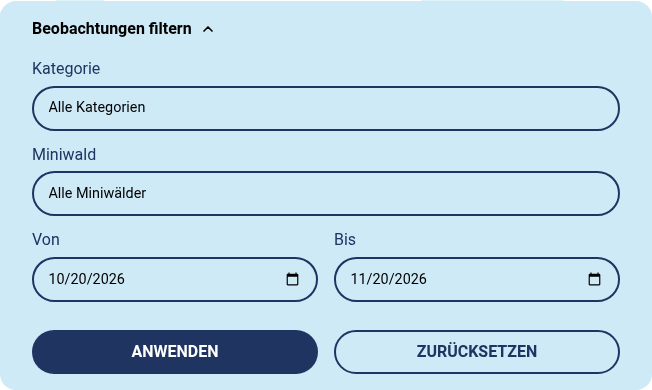

# Miniwald-Explorer

Welche Vögel besuchen den Miniwald? Welche Schmetterlinge lassen sich im Sommer beobachten? Im Miniwald-Explorer dokumentieren Schulklassen, Jugendgruppen und Ehrenamtliche, was sie in den sieben Miniwäldern rund um den Tagebau Inden entdecken. So entsteht mit der Zeit eine gemeinsame Sammlung zur Artenvielfalt im Rheinischen Revier.

**[Miniwald-Explorer live öffnen](https://miniwald-explorer.de/)** · [Öffentliche Beobachtungen ansehen](https://miniwald-explorer.de/collection/observations)

**Auftraggeberin:** Entwicklungsgesellschaft indeland GmbH. Helm & Walter IT-Solutions GmbH hat die Web-App für das Citizen-Science-Projekt *inReNa 2030 II* entwickelt. Die Miniwälder sind Lernorte in Aldenhoven, Eschweiler, Inden, Jülich, Langerwehe, Linnich und Niederzier.

## Mit der Forscherbox in den Miniwald

Mit Lupen und Schaufeln aus der Forscherbox können Kinder zum Beispiel den Boden nach Tieren absuchen. Die Gruppe hält ihre Funde direkt auf dem Smartphone oder Tablet fest. Wer lieber mit Stift und Beobachtungsbogen arbeitet, kann die Ergebnisse später übertragen. Papierbogen und App verwenden dieselben Kategorien.


Beim Zählen von Vögeln trägt die Gruppe je Art ein, wie viele Tiere sie gleichzeitig gesehen hat. Für Pflanzen und Umweltbedingungen gibt es eigene Erfassungsmasken, etwa für Bodenfeuchte und Temperatur. So lassen sich Beobachtungen von verschiedenen Tagen und Standorten vergleichen.

## Die Sammlung erkunden

Wer wissen möchte, welche Vogelbeobachtungen es aus Jülich gibt, kann die öffentliche Sammlung nach **Kategorie**, **Miniwald** und **Zeitraum** filtern. Die Sammlung enthält außerdem Artenporträts und stellt die sieben Miniwälder vor. [Zur Sammlung](https://miniwald-explorer.de/collection)



Die Abbildung mit der Forscherbox stammt aus dem [Projektbericht von Helm & Walter](https://helmundwalter.de/portfolio/miniwald-explorer). Der Screenshot zeigt die Filter der Live-Anwendung.

<details>
<summary>Quellcode, Installation und Tests</summary>

Der Anwendungscode steht unter der [MIT-Lizenz](LICENSE). Voraussetzung sind Shopware 6.7 und PHP ab 8.3. Das Repository unter `custom/plugins/MiniwaldExplorer` einbinden und im Shopware-Hauptverzeichnis ausführen:

```sh
bin/console plugin:refresh
bin/console plugin:install --activate MiniwaldExplorer
bin/build-administration.sh
bin/build-storefront.sh
```

Eigene freigegebene Medien können an den in den Templates angegebenen Pfaden hinterlegt werden, eigene Artdaten vor der ersten Installation in `src/Resources/data/species-data.csv`. Für die optionale Karte die Dateien `maplibre-gl.js` und `maplibre-gl.css` aus [MapLibre GL JS 5.23.0](https://github.com/maplibre/maplibre-gl-js/releases/tag/v5.23.0) unter `src/Resources/public/assets/map/` ablegen, `bin/console assets:install` ausführen und in der Pluginkonfiguration einen Kartenstil eintragen. Für die Bibliothek gelten deren Lizenz- und Attributionshinweise.

Im Pluginverzeichnis führt `node --test tests/Storefront/*.test.mjs` die Storefront-Tests aus. Die PHP-Tests unter `tests/Unit` und `tests/Integration` verwenden PHPUnit und die Shopware-Testumgebung. Für Integrationstests eine eigene Testdatenbank verwenden.

</details>
